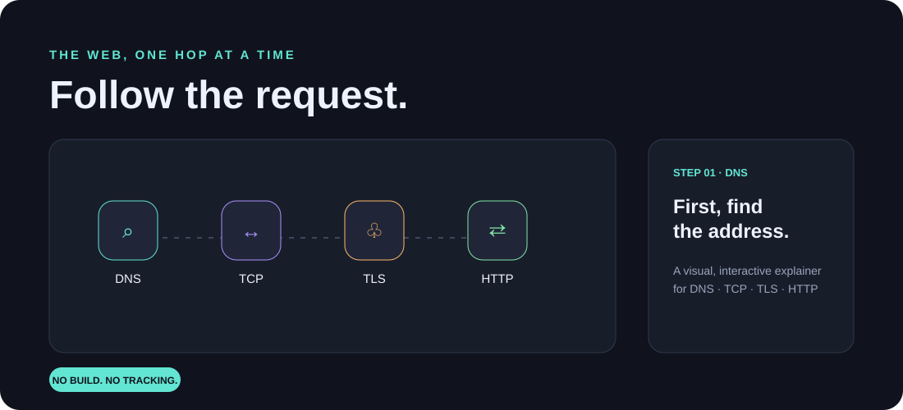

# Packet Playground

**Follow a web request from a human-friendly hostname to a page on your screen.** Packet Playground is a no-build, browser-only visual explainer for the steps behind a typical HTTPS page load: DNS, TCP, TLS, and HTTP.



## Try it

Open [`index.html`](index.html) in any modern browser, or use the GitHub Pages deployment link once enabled. There are no dependencies, build steps, accounts, or network requests. The destination IP is a deterministic illustrative value, not a real DNS lookup; no packets leave the browser.

## What you can explore

- Step through the request automatically or manually.
- Try a different hostname or one of the presets.
- See the journey, timeline, and request readout update together.
- Learn what each layer does in plain language.
- Use it on a narrow screen; the layout adapts for mobile.

## Run locally

```bash
git clone https://github.com/iadithyan479-wq/packet-playground.git
cd packet-playground
python3 -m http.server 8000
```

Then open <http://localhost:8000>.

## Concepts in the model

1. **DNS** resolves a hostname to an address (often from a cache).
2. **TCP** establishes a reliable connection with a three-way handshake.
3. **TLS** validates identity and negotiates encryption keys.
4. **HTTP** sends a request and receives a response over the secure connection.

This is an intentionally simplified teaching model: real browsers may reuse connections, use QUIC instead of TCP, resolve records in multiple stages, and exchange many more messages.

## Built with

Plain HTML, CSS, and JavaScript. No frameworks, trackers, or external assets.

## License

MIT — see [LICENSE](LICENSE).
